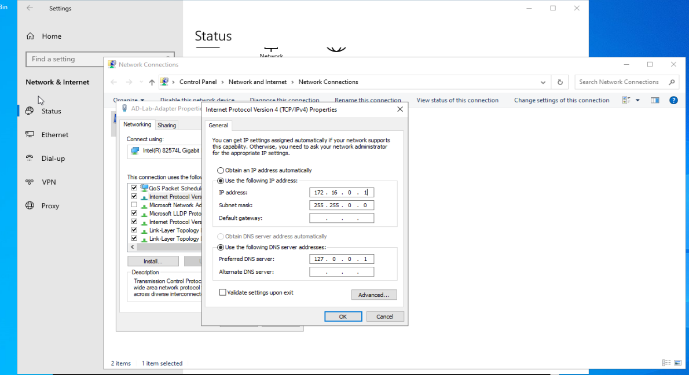

# Active Directory Setup - Windows Server 2022

## 1) Domain Controller Setup

- Install Windows Server 2022 in VMWare
- Congifure Networks
    - **Nat-Lab-Adapter**: Bridged Network
    - **AD-Lab-Adapter**: Internal Network
- Assign Static IP for Internal Network: 172.16.0.1
- Install **Active Directory Domain Services** and promote the server to a Domain Controller for the root domain

