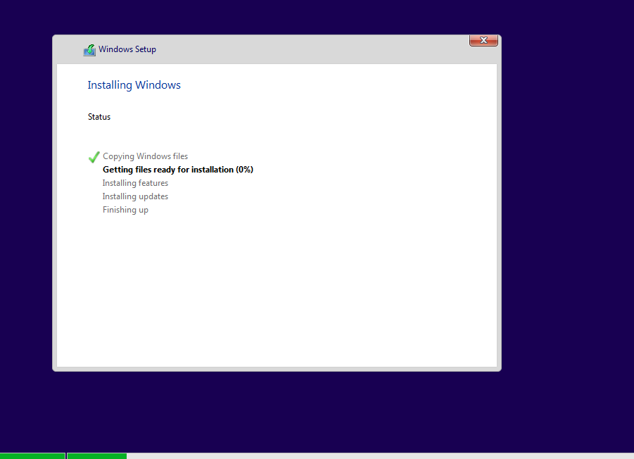
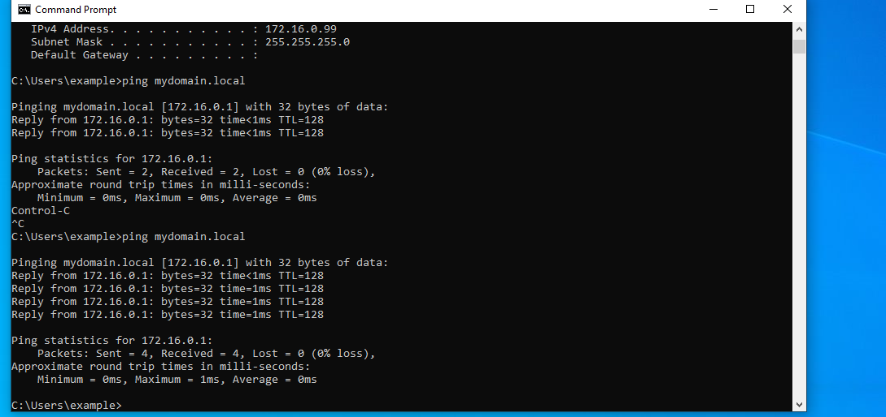
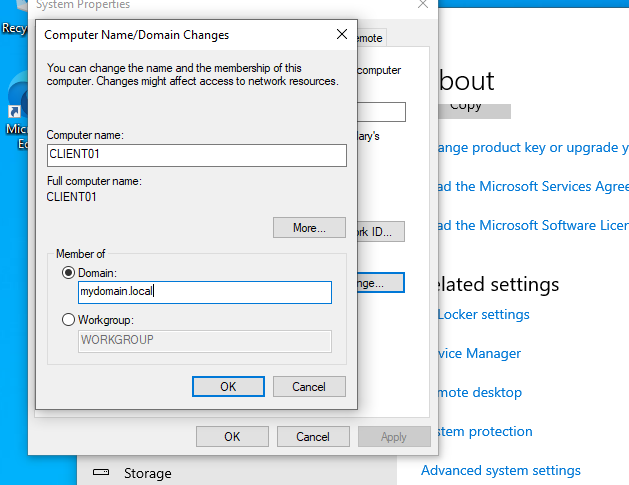
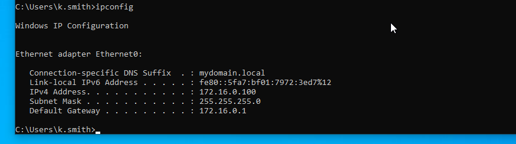

# Windows 10 - Client Machine

## Client Machine Setup

- Created VM Client Machine name to `**CLIENT01**`
- Configured network adapter to use **internal network**
- Joined the domain: `mydomain.local`
- Verified internal network lease

