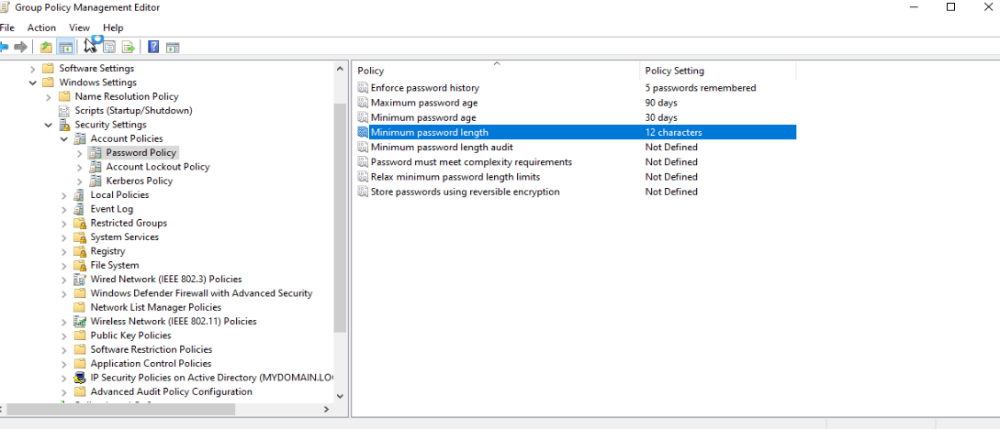
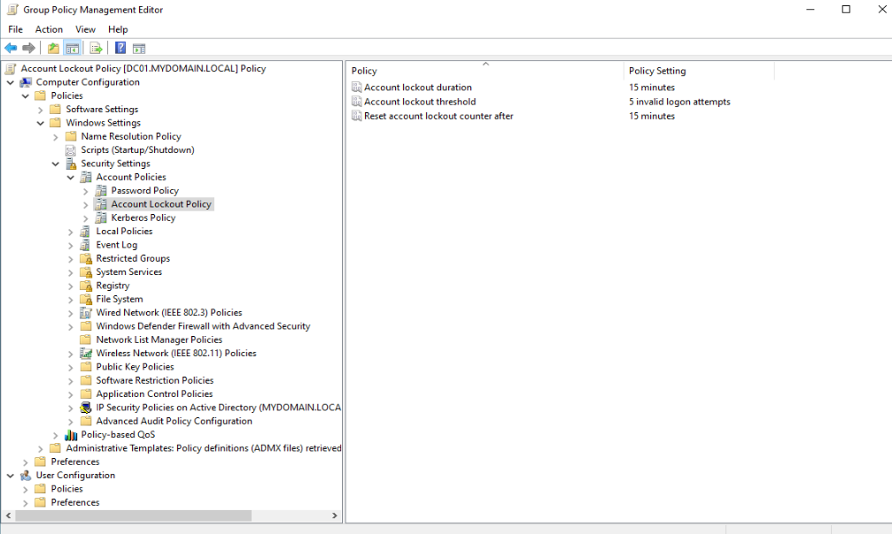
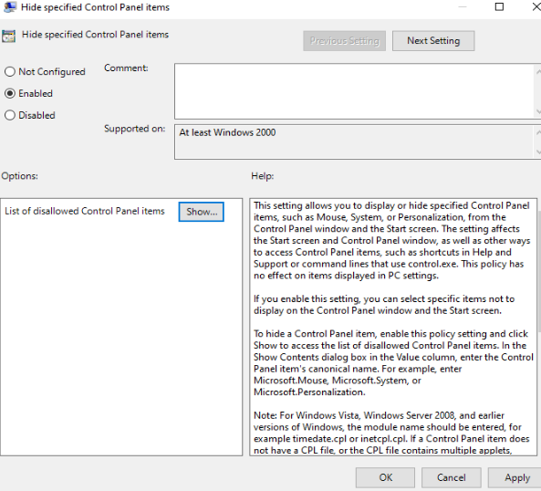
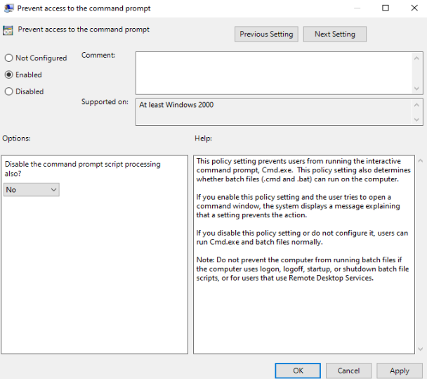
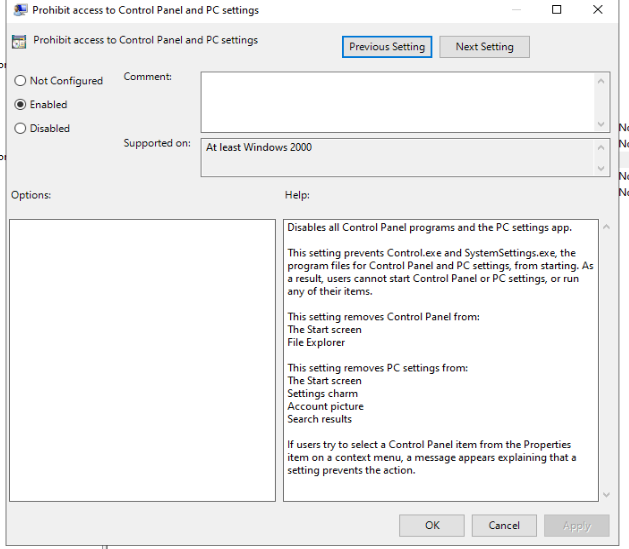

# Group Policy (GPO) Management

## Password Policy

- Created domain-level password policy
  - Minimum Length: `12 Characters`
  - Password Complexity: `Enabled`
  - Maximum Password Age: `90 Days`
  - Password History: `5 Passwords`

### Purpose

This policy helps enforce stronger passwords to reduce the likelihood of unauthorized access.

## Account Lockout Policy

- Configured account lockout protections to defend against password guessing
  - Failed Login Attempts: `5`
  - Lockout Duration: `15 Minutes`
  - Reset Counter After: `15 Minutes`
 
### Purpose

This policy configured account lockout protections against brute-force authentication attemps.

## Desktop Restrictions

- Created a security policy to restrict access for standard users
  - Disabled Control Panel Access
  - Prevented Command Prompt Access
  - Restricted Administrative Settings

### Purpose

This policy reduces the risk of unauthorized system changes by end users.
