# PowerShell User Administration

The goal is to learn how PowerShell can be used for common automated tasks, reduce manual effort, and improve consistency when managing user accounts with Active Directory

## Verify Active Directory

Before Managing Active Directory through PowerShell, verify that the AD module is available.

**COMMAND**: `Get-Module -ListAvailable ActiveDirectory`

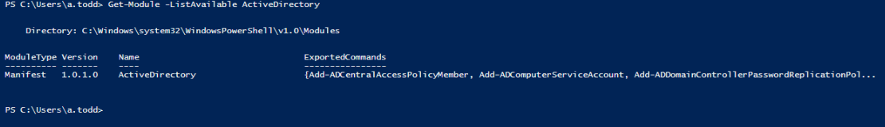

- Successfully confirmed the Active Directory Module was installed on the Domain Controller

## Retrieve Active Directory Users

Displays all user accounts in Active Directory

**COMMAND**: `Get-ADUser -Filter *`

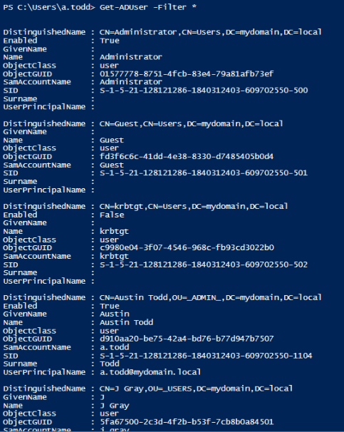
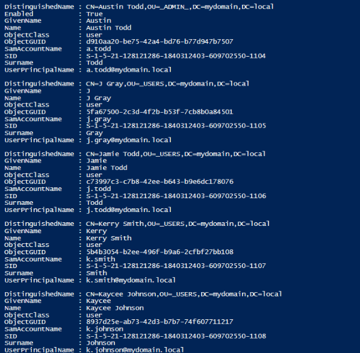
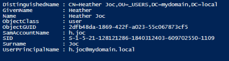

- Successfully retrieved domain users from Active Directory

## Created New User Account

Create a new Active Directory user account through PowerShell

**COMMAND**: 
`New-ADUser 
-Name "John Smith" 
-GivenName "John" 
-Surname "Smith" 
-SamAccountName "j.smith" 
-UserPrincipalName "jsmith@mydomain.local" 
-Path "OU=_USERS,DC=mydomain,DC=local" 
-AccountPassword (ConvertTo-SecureString "P@ssword123!" -AsPlainText -Force) 
-Enabled $true`

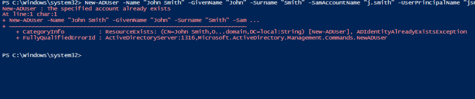

- Successfully created and enabled a new domain user

## Disable User Account

Disable a user account 

**COMMAND**: `Disable-ADAccount -Identity j.smith`

- Successfully disabled the selected account

## Enable User Account

Re-enable a disabled account

**COMMAND**: `Enable-ADAccount -Identity j.smith`

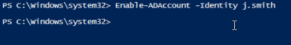

- Successfully restored account access

## Unlock Locked User Account

Unlock a user account that has been locked due to failed login attempts

**COMMAND**: `Unlock-ADAccount -Identity j.smith`

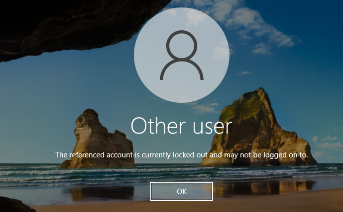
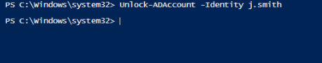

- Successfully unlocked the account

## Reset User Password

Reset a user's password using PowerShell

**COMMAND**: 
`Set-ADAccountPassword 
-Identity jsmith 
-Reset 
-NewPassword (ConvertTo-SecureString "NewPassword123!" -AsPlainText -Force)`

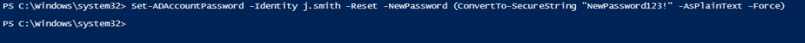

- Successfully updated user credentials

## Add User to Security Group

Assign a user to a security group

**COMMAND**:
`Add-ADGroupMember
-Identity "IT-Group"
-Members j.smith`

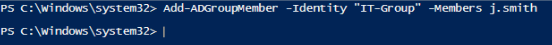

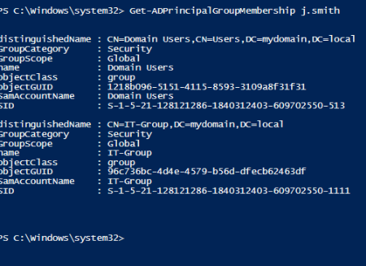

- Successfully added the account to the designated group

## Remove User from Security Group

Remove a user from a security group

**COMMAND**:
`Remove-ADGroupMember
-Identity "GG_Standard_Users"
-Members j.smith`

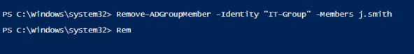
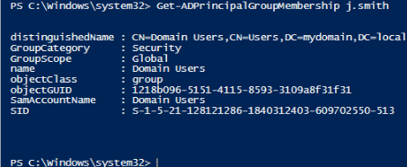
 

- Successfully removed the account from the group

## Review Group Membership

Display all security groups assigned to a user

**COMMAND**: `Get-ADPrincipalGroupMembership j.smith`

- Verified group membership assignments

## Key Takeaways

- Learned how PowerShell can be used to automate certian tasks
- Reduced reliance on the Active Directory Users and Computers GUI
- Gained experience performing common help desk and system administration functions
- Improved understanding of Identity and Access management concepts
