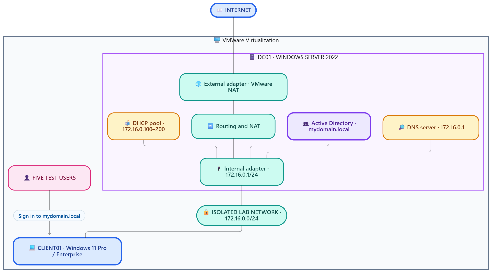

# Active Directory Home Lab

## Overview

This is a **Active Directory (AD) Home Lab built using VMWare, Windows Server 2022, and Windows 10**.  The lab is simulating a corporate environment where a domain controller manages DHCP, DNS, NAT, and Windows Clients.

The goal of this lab is to strengthen my knowledge of:
  - **Active Directory (AD)**
  - **Networking Services**
  - **Domain and User Management**

## Lab Diagram

## Lab Setup

- [**Domain Controller (DC)**: Windows Server 2022](./docs/ad-setup.md)
- **Windows Client**: Windows 10
- **Virtualization**: VMWare
- **Domain**: `mydomain.local`

## Key Configurations

- Installed AD DS and promote to a Domain Controller
- Created **Organizational Units** to create _USER and _ADMIN
- Configured DHCP lease from `172.16.0.100 - 172.16.0.200`
- Joined **Windows 10 Client Machine** to the domain

## Key Takeaways

- Built and configured an **Active Directory** from scratch
- Learned how **DNS, DHCP, and NAT** integrated into the environment
- Successfully **joined and authenticated a client machine** within the domain
